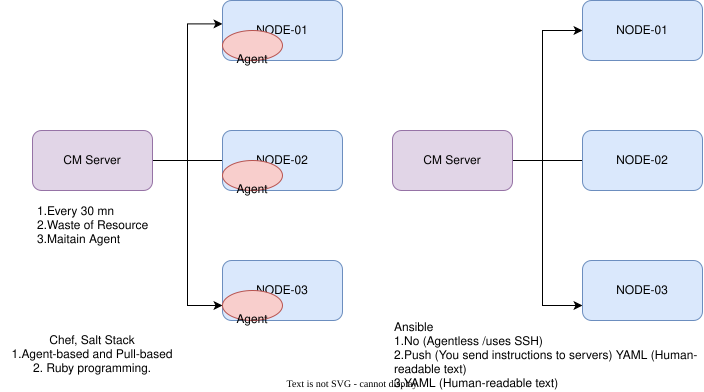

## shell disadvantages
  1. **No idempotency**
  2. **No error handling**
  3. **Shell is imperative, commands should be in order**
  4. **can't handle at a scale**
  5. **Homogenous -> works only for specific distro**
  6. **can't store secrets securely**

  ## Configuration
 - **Plain server -> ready to host application**
     - **Installing programming language**
     - **Creating system user**
     - **Creating app directory**
     - **Downloading code**
     - **Unzipping code**
     - **Installing dependencies**
     - **Creating systemctl service files**
     - **Loading data if necessary**
     - **Starting the server**

**CRUD**
- **Reading the configuration -> what is there inside server**
- **updating the configuration -> update the script and run it**
- **Delete the configuration -> write the script and run it**
 
 
 

## Inventory 
- **inventory means list of items in ansible**
- **in Linux--> we call commands**
- **in Ansible --> we call  module/Collection**
- **ansible adhoc command -> we use in emergency purpose targeting one time simple task**
    - **ansible all -i 172.31.33.29, -e ansible_user=ec2-user -e ansible_password=DevOps321 -m ping**
    - **ansible all -i 172.31.33.29, -e ansible_user=ec2-user -e ansible_password=DevOps321 -b -m dnf -a "name=nginx state=installed"**
    - **Repetitive -> we will keep all the modules in a file called playbook. It is YAML based**

# DTO --> Data Tranfor Objects
  - **YAML  :-> Yet another markup language**
  - **HTML  :-> Hyper text markup language**
  - **XML   :-> Extensive markup language**
  - **JSON  :-> Java Script object notation**

- **[]** --it indicates in ansible **List**
- **{}** --it indicates **map/objects**

- **ansible everything is module or collection**
- **Inventory** --> machines ansible is tracking